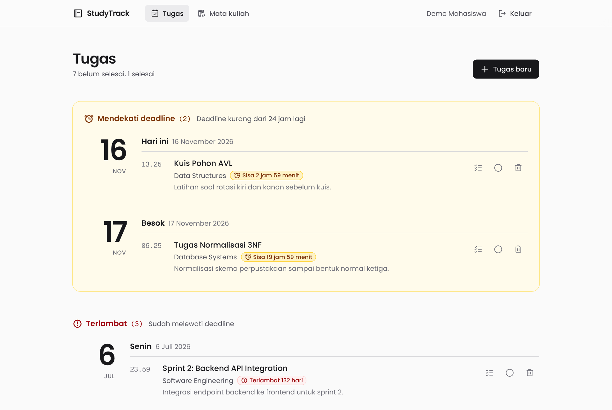
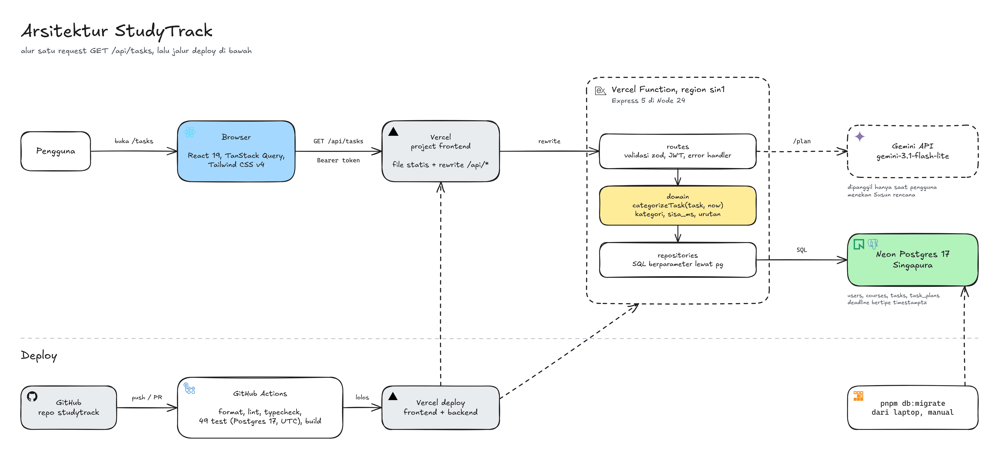
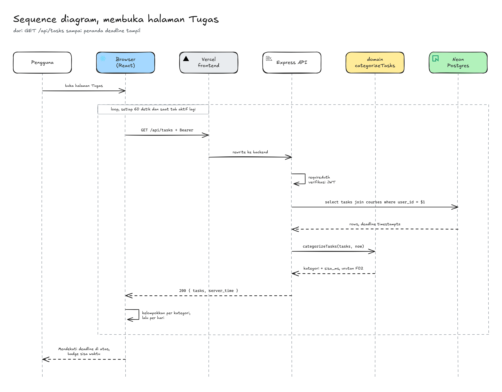
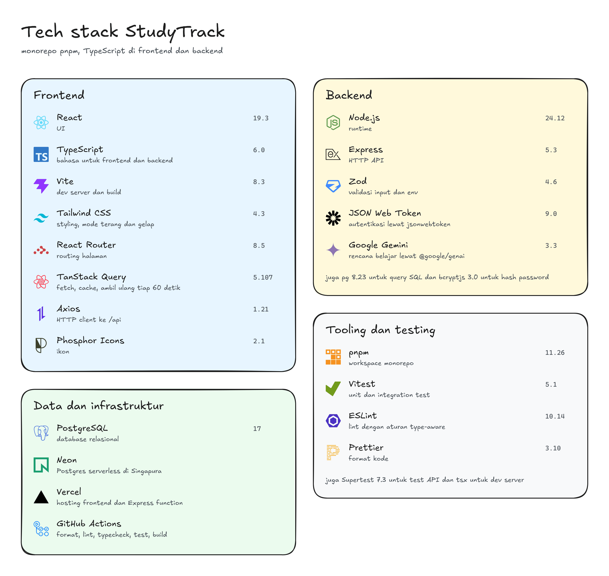
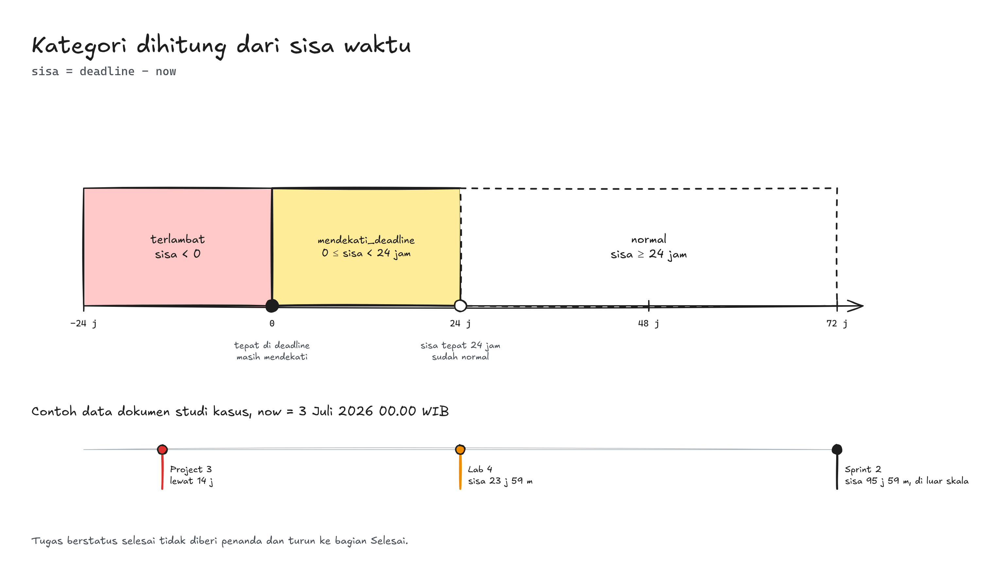

# StudyTrack

[](https://github.com/dimaswirabakti/studytrack/actions/workflows/ci.yml)

StudyTrack mencatat tugas kuliah per mata kuliah. Tugas yang deadline-nya tinggal kurang dari 24 jam naik ke urutan paling atas dengan hitung mundur, dan tugas yang sudah lewat deadline diberi tanda terlambat. Repo ini adalah jawaban saya untuk studi kasus Software Engineer Academya Arkavidia 11.0, dibangun di atas starter kit dari panitia.

Aplikasi live ada di **https://studytrack-app-ten.vercel.app**. Masuk dengan `demo@studytrack.test` / `demo1234`, atau tekan Coba akun demo di halaman masuk.



## Fitur reminder deadline

Halaman Tugas membagi tugas yang belum selesai ke tiga bagian. Mendekati deadline selalu berada paling atas dengan latar amber, dan setiap tugas di dalamnya membawa badge seperti "Sisa 2 jam 59 menit". Terlambat memuat tugas yang sudah lewat deadline dengan badge merah seperti "Terlambat 3 hari". Mendatang memuat sisanya. Tugas yang sudah selesai pindah ke bagian Selesai di bawah, yang bisa dibuka dan ditutup.

Penanda berlaku untuk semua tugas milik pengguna yang sedang masuk, dari mata kuliah mana pun. Daftar diambil ulang setiap 60 detik dan setiap kali tab kembali aktif, sehingga tugas bisa berpindah dari Mendatang ke Mendekati deadline tanpa reload.

Di luar kebutuhan studi kasus, setiap tugas yang belum selesai bisa dibuatkan rencana kerja oleh Gemini. Rencananya berisi 2 sampai 6 langkah dengan estimasi menit, dan aplikasi memberi peringatan kalau total estimasinya lebih lama dari sisa waktu.

## Arsitektur



Frontend dan backend adalah dua project Vercel dari satu repo. Browser hanya berbicara dengan domain frontend, lalu rewrite di `frontend/vercel.json` meneruskan `/api/*` ke function Express. Kode frontend memakai `baseURL: "/api"` yang sama di lokal (lewat proxy Vite) dan di production, dan backend tidak butuh CORS. Function dan database sama-sama berada di Singapura.

Backend punya tiga lapis. `routes/` mengurus HTTP, validasi zod, dan autentikasi. `domain/` berisi logika murni yang tidak menyentuh database ataupun jam sistem, termasuk `categorizeTask`. `repositories/` berisi query SQL. Karena waktu sekarang masuk sebagai parameter, logika kategori bisa diuji dengan waktu yang ditentukan sendiri.

Urutan pemanggilan saat halaman Tugas dibuka:



## Tech stack



## Aturan kategori



| Kondisi                                 | Kategori             | Tampilan                        |
| --------------------------------------- | -------------------- | ------------------------------- |
| `sisa < 0`                              | `terlambat`          | Bagian Terlambat, badge merah   |
| `0 ≤ sisa < 24 jam`                     | `mendekati_deadline` | Bagian paling atas, badge amber |
| `sisa ≥ 24 jam`                         | `normal`             | Bagian Mendatang, tanpa badge   |
| status `selesai`, berapa pun sisa waktu | `selesai`            | Bagian Selesai, tanpa penanda   |

Dokumen kebutuhan tidak membahas beberapa kasus tepi, jadi saya memutuskannya sendiri:

1. Sisa tepat 24 jam termasuk normal, karena syaratnya "kurang dari 24 jam".
2. Pada detik deadline, tugas belum terlambat. Terlambat berarti deadline sudah terlewati.
3. Tugas berstatus selesai tidak diberi penanda, walaupun deadline-nya dekat atau sudah lewat.
4. Deadline lama dari starter kit tidak menyimpan zona waktu, jadi migrasi menganggapnya WIB.

## Perubahan per layer

| Layer    | Perubahan                                                                                                                                                     | File utama                                                           |
| -------- | ------------------------------------------------------------------------------------------------------------------------------------------------------------- | -------------------------------------------------------------------- |
| Database | Kolom `deadline` berubah dari `timestamp` ke `timestamptz`, index `(user_id, deadline)`. Kategori tidak disimpan karena nilainya ikut bergeser seiring waktu. | `backend/migrations/002_deadline_timestamptz.sql`                    |
| Backend  | `categorizeTask` dan `categorizeTasks`. `GET /api/tasks` mengirim `kategori`, `sisa_ms`, dan `server_time` dengan urutan yang sudah final.                    | `backend/src/domain/task-category.ts`, `backend/src/routes/tasks.ts` |
| Frontend | Bagian per kategori, badge hitung mundur, pengambilan ulang tiap 60 detik. Frontend memakai kategori dari backend tanpa menghitung ulang.                     | `frontend/src/features/tasks/TasksPage.tsx`, `DeadlineBadge.tsx`     |

Starter kit menyimpan deadline seperti `2026-07-03T23:59`, tanpa zona waktu. Di laptop yang memakai WIB hasilnya terlihat benar, tetapi server Vercel berjalan dalam UTC sehingga sisa waktu meleset 7 jam. Sekarang database menyimpan waktu absolut, frontend mengirim deadline dalam ISO 8601 UTC, dan backend menolak deadline yang tidak menyertakan zona waktu.

Badge hitung mundur memakai `sisa_ms` dari server dikurangi waktu yang sudah berjalan sejak data diambil, sehingga jam perangkat yang salah tidak memengaruhi angkanya.

## Menjalankan di lokal

Siapkan Node 24.12 atau lebih baru, pnpm 11, dan satu database Postgres. Saya memakai branch Neon terpisah untuk development.

```bash
pnpm install
cp backend/.env.example backend/.env
pnpm --filter @studytrack/backend db:migrate
pnpm --filter @studytrack/backend db:seed
pnpm dev
```

Isi `DATABASE_URL` dan `JWT_SECRET` di `backend/.env` sebelum menjalankan migrasi. `GEMINI_API_KEY` boleh kosong, dan panel rencana AI akan menampilkan keterangan bahwa fitur belum aktif. Frontend berjalan di http://localhost:5173 dan backend di http://localhost:4000.

Data seed berisi tiga tugas dari dokumen studi kasus ditambah lima tugas yang deadline-nya dihitung dari waktu seed dijalankan, supaya semua kategori langsung terlihat.

## Test dan CI

```bash
pnpm test
```

Ada 49 test. Unit test mencakup aturan kategori dengan data dokumen studi kasus, format label waktu, prompt dan parsing jawaban Gemini, serta rate limiter. Sebelas integration test memanggil API lewat Supertest ke Postgres sungguhan dengan waktu yang dibekukan, termasuk pengecekan bahwa pengguna lain tidak bisa melihat atau menambah tugas ke mata kuliah milik orang lain.

Integration test hanya membaca `TEST_DATABASE_URL` dari `backend/.env.test` (contohnya ada di `backend/.env.test.example`), sehingga test tidak pernah mengosongkan database development atau production. Kalau variabel itu kosong, integration test dilewati.

GitHub Actions menjalankan format check, lint, typecheck, test, dan build di setiap push dan pull request. Runner memakai Postgres 17 dan zona waktu UTC, sama seperti production.

## Deploy

| Project Vercel | Root directory | Environment variable                                                                                                    |
| -------------- | -------------- | ----------------------------------------------------------------------------------------------------------------------- |
| Backend        | `backend`      | `DATABASE_URL`, `JWT_SECRET`, `GEMINI_API_KEY`, `GEMINI_MODEL`, `NODE_ENV=production`, `ENABLE_EXPERIMENTAL_COREPACK=1` |
| Frontend       | `frontend`     | `ENABLE_EXPERIMENTAL_COREPACK=1`                                                                                        |

Vercel men-deploy kedua project setiap ada push ke `main`. Migrasi database production saya jalankan manual dari laptop:

```bash
DATABASE_URL='<connection string production>' pnpm --filter @studytrack/backend db:migrate
```

Endpoint `POST /api/dev/reset` hanya terdaftar di luar production.

## Batasan yang saya ketahui

- Rate limit rencana AI (5 permintaan per 10 menit per pengguna) disimpan di memori function, jadi tidak dibagi antar instance Vercel.
- Ambang 24 jam masih berupa konstanta `DUE_SOON_WINDOW_MS` dan belum bisa diatur pengguna.
- Penanda hanya terlihat saat aplikasi dibuka. Belum ada notifikasi email atau push.
- Token login masih disimpan di `localStorage`, sama seperti starter kit.

## Struktur repo

```
backend/
  migrations/          file SQL berurutan, dicatat di tabel schema_migrations
  src/ai/              prompt, schema, dan pemanggil Gemini
  src/domain/          logika kategori deadline
  src/repositories/    query SQL per tabel
  src/routes/          handler HTTP
  test/                integration test
frontend/
  src/features/tasks/  halaman Tugas, agenda, badge, panel rencana
  src/features/courses/
  src/lib/             klien API, tipe data, format tanggal
docs/                  diagram dan screenshot README
  diagrams/            sumber .excalidraw, bisa dibuka di excalidraw.com
```

## Kredit

Starter kit [StudyTrack](https://github.com/ZulfaNurhuda/StudyTrack) disediakan panitia Academya Arkavidia 11.0. Ikon dari Phosphor, huruf Poppins dan Geist Mono.
